# SkyOps Self-Hosted Architecture Specification

## 1. Executive Summary & Topology

The SkyOps self-hosted distribution allows enterprise customers to run the complete SkyOps incident intelligence, telemetry aggregation, operations workspace, and cost intelligence control plane inside their own private infrastructure (on-premises or private cloud VPC).

Customers run **one central SkyOps control plane installation** per enterprise organization on an **Ubuntu Server x86-64 host**. Remote and local Kubernetes clusters run the lightweight, battle-tested Go agent (`skyops-agent` v1.5.1), which streams real telemetry back to the control plane over secure, egress-only HTTPS connections.

```mermaid
flowchart TB
    subgraph CustomerHost["Customer Host: Ubuntu Server x86-64"]
        subgraph DockerCompose["Docker Compose Control Plane Environment"]
            ReverseProxy["Reverse Proxy (Caddy / Nginx / Traefik)<br/>Port 80/443 (TLS Termination)"]
            
            subgraph ControlPlaneContainer["skyops-control-plane (Container: Node.js / Express / React)"]
                API["Express REST API & WebSocket Ingestion<br/>(/api/v1/*, /api/agent/*)"]
                AuthModule["Local Auth Engine & Identity Provider<br/>(JWT + Argon2id / bcrypt)"]
                Engine["SkyOps Incident Intelligence & Correlation Engine"]
                RemediationManager["Autonomous Remediation & Ops Manager"]
                CostEngine["Kubernetes Cost & FinOps Intelligence Engine"]
                WebAssets["Vite SPA Static Frontend Assets"]
            end
            
            subgraph StorageLayer["Data & Persistence Layer"]
                PostgresDB[("PostgreSQL 16 Database<br/>(Durable Relational Storage)")]
                LocalArtifacts[("Host Volume: /var/lib/skyops/data/artifacts<br/>(Incident Bundles, Postmortems, Reports)")]
                RedisCache[("Redis 7 (Optional / Phase 4+)<br/>(PubSub, Ephemeral Caching, Rate Limiting)")]
            end
        end
    end

    subgraph RemoteCluster1["Customer Kubernetes Cluster: Production (EKS / GKE / AKS / Baremetal)"]
        Agent1["SkyOps Go Agent (v1.5.1 Pod)<br/>Deployment: skyops-agent<br/>Namespace: skyops-system"]
        KubeAPI1["Kubernetes API Server<br/>(In-Cluster ServiceAccount & RBAC)"]
        Agent1 -- "Read telemetry, events, pod logs" --> KubeAPI1
        Agent1 -- "Execute approved remediations" --> KubeAPI1
    end

    subgraph RemoteCluster2["Customer Kubernetes Cluster: Staging (On-Premises / Rancher / k3s)"]
        Agent2["SkyOps Go Agent (v1.5.1 Pod)<br/>Deployment: skyops-agent<br/>Namespace: skyops-system"]
        KubeAPI2["Kubernetes API Server<br/>(In-Cluster ServiceAccount & RBAC)"]
        Agent2 -- "Read telemetry, events, pod logs" --> KubeAPI2
        Agent2 -- "Execute approved remediations" --> KubeAPI2
    end

    subgraph Users["Customer IT / DevOps / SRE Team"]
        Browser["Operator Web Browser<br/>(HTTPS Web UI)"]
    end

    %% Communication Flow
    Browser -- "HTTPS :443 (Web UI, REST API)" --> ReverseProxy
    ReverseProxy -- "Proxy HTTP :3000" --> API
    Agent1 -- "HTTPS Egress (Heartbeat, Telemetry, Logs)<br/>Authorization: Bearer <ClusterToken>" --> ReverseProxy
    Agent2 -- "HTTPS Egress (Heartbeat, Telemetry, Logs)<br/>Authorization: Bearer <ClusterToken>" --> ReverseProxy

    API --> PostgresDB
    API --> LocalArtifacts
    API -.-> RedisCache
    API --> AuthModule
    API --> Engine
```



---

## 2. Customer Server Component Architecture

### 2.1 Operating System & Host Environment
- **Host OS**: Ubuntu Server 22.04 LTS or 24.04 LTS (x86-64).
- **Container Runtime**: Docker Engine 24.0+ and Docker Compose v2.20+.
- **Resource Footprint**:
  - *Minimum*: 4 vCPUs, 8 GB RAM, 50 GB SSD persistent storage.
  - *Recommended (10+ clusters, 500+ pods)*: 8 vCPUs, 16 GB RAM, 200 GB NVMe storage.

### 2.2 Docker Compose Service Definitions

1. **`skyops-control-plane`**:
   - **Base Image**: Multi-stage Node.js 22 LTS Alpine image.
   - **Responsibilities**:
     - Serves compiled React frontend SPA.
     - Runs Express API server (`/api/v1/*`, `/api/agent/*`).
     - Houses local authentication engine, JWT issuer, and session manager.
     - Hosts Incident Intelligence, Correlator, Cost Engine, and Security Engine.
     - Connects to PostgreSQL using `PostgresStore` (implementing `IPersistenceStore`).
   - **Internal Port**: `3000` (bridged to reverse proxy).
   - **Persistent Volumes**: `/var/lib/skyops/data` (for local artifacts, crash bundles, PDF postmortems).

2. **`skyops-postgres`**:
   - **Base Image**: `postgres:16-alpine`.
   - **Responsibilities**:
     - Holds all relational records (organizations, memberships, users, credentials, clusters, tokens, incidents, remediations, policies, logs, audit trails).
   - **Persistent Volume**: `skyops_pgdata:/var/lib/postgresql/data`.
   - **Configuration**: Tuned for connection pooling, WAL retention, and automatic daily vacuuming.

3. **`skyops-proxy` (Reverse Proxy / TLS Termination)**:
   - **Base Image**: `caddy:2-alpine` or `nginx:alpine`.
   - **Responsibilities**:
     - Automatic Let's Encrypt TLS certificate provisioning (or custom corporate CA certificate mounting).
     - HTTPS on Port 443; HTTP-to-HTTPS redirect on Port 80.
     - Request buffering, Gzip/Brotli compression, and rate limiting for agent telemetry ingestion.

4. **`skyops-redis` (Optional)**:
   - **Base Image**: `redis:7-alpine`.
   - **Responsibilities**:
     - Ephemeral cache and WebSocket state pub/sub for high-availability multi-instance setups. Not strictly required for single-node deployments as in-process channels handle current workloads efficiently.

---

## 3. Monitored Remote Kubernetes Clusters

Monitored Kubernetes clusters **do not run the SkyOps server or database**. They run solely the lightweight **Go agent** (`skyops-agent`), preserving minimal resource impact and strict isolation.

### 3.1 Go Agent Architecture (`skyops-agent` v1.5.1)
- **Container Memory**: 64Mi request / 256Mi limit.
- **Container CPU**: 50m request / 250m limit.
- **Security Context**:
  - `readOnlyRootFilesystem: true`
  - `allowPrivilegeEscalation: false`
  - `runAsNonRoot: true` (UID: 65532)
  - `capabilities.drop: ["ALL"]`
- **Sub-Services in Agent**:
  - `collector`: Watches Kubernetes API endpoints (Pods, Nodes, Events, Services, Ingresses, Metrics).
  - `logCollector`: Streams pod/container logs for anomaly detection.
  - `heartbeat`: Transmits 15-second heartbeats containing node and pod counts.
  - `remediation`: Receives approved, policy-governed mutation instructions (e.g. rollout restart, pod eviction) and executes them using standard `client-go` APIs.
  - `spool`: Durable on-disk queue (`/var/spool/skyops`) buffering telemetry during transient network disconnections.

### 3.2 Helm Distribution
- Chart: `agent/deploy/helm`
- Installation command:
  ```bash
  helm upgrade --install skyops-agent skyops/skyops-agent \
    --namespace skyops-system \
    --create-namespace \
    --set serverUrl="https://skyops.yourdomain.com" \
    --set clusterId="cl_prod_us_east_1" \
    --set agentToken="sky_tok_9f81a7b3c2e4..."
  ```

---

## 4. Network Security, Authentication & Isolation

### 4.1 Direction of Traffic
- **All cluster-to-control-plane communication is EGRESS-ONLY from the cluster**.
- The SkyOps control plane **never initiates inbound connections** into customer Kubernetes clusters.
- Agents behind firewalls, NATs, and air-gapped private VPCs need only outbound HTTPS (Port 443) access to the SkyOps control plane server URL.

### 4.2 Cluster Authentication
- Each cluster is assigned a unique, cryptographically random `agentToken` during registration.
- The control plane stores the SHA-256 hash of this token in `cluster_tokens`.
- Every agent request carries `Authorization: Bearer <agentToken>`.
- The `requireAgentAuth` middleware verifies the hash and binds the request strictly to `req.clusterId` and `req.orgId`.

### 4.3 Tenant & RBAC Isolation
- Every entity in the database is tagged with `org_id` / `tenant_id`.
- The `validateTenantBoundary` guard function enforces strict tenant isolation:
  - Any request attempting to query or mutate a resource belonging to a different tenant triggers an immediate `UnauthorizedTenantAccessException` (HTTP 403) and writes a high-priority security audit event.

---

## 5. Persistence, Identity & Storage Implementation (Phase 2)

### 5.1 Relational Schema & Table Definitions
The self-hosted engine implements 27 PostgreSQL tables mapped directly to `IPersistenceStore` entities:
- **Core Entities**: `tenants`, `users`, `local_credentials`, `clusters`, `agent_tokens`, `agent_configs`.
- **Operational Data**: `incidents`, `nodes`, `workloads`, `telemetry_snapshots`, `time_series_metrics`, `log_entries`, `event_entries`.
- **Incident Intelligence**: `investigation_graphs`, `diagnostic_runs`, `evidence_records`, `slos`, `slo_burn_events`.
- **Remediation & Governance**: `auto_healing_policies`, `remediation_records`, `remediation_approvals`, `audit_logs`, `agent_audit_logs`, `api_keys`.
- **FinOps Intelligence**: `cost_metrics`, `cost_policies`, `cost_recommendations`.

All tables include appropriate foreign key constraints with `ON DELETE CASCADE` or `ON DELETE SET NULL`, explicit indexes for multi-tenant and time-series queries, and automatic timestamps.

### 5.2 Local Authentication Engine (`server/auth/localAuth.ts`)
- **First-Run Wizard**: `POST /api/v1/auth/setup` allows initial administrator account setup when `userCount === 0`. Subsequent calls are permanently blocked with `403 Forbidden`.
- **Password Protection**: Passwords hashed using `bcrypt` (12 rounds) with dedicated salt stored in `local_credentials`.
- **Session Tokens**: HMAC-SHA256 signed JWTs stored in `skyops_session` httpOnly, SameSite=Lax cookies, with Bearer header fallback.
- **Brute-Force Guard**: IP-based rate limiting (5 failed attempts per 5-minute window locks the IP for 15 minutes).

### 5.3 Storage Drivers (`server/storage/drivers/LocalStorageDriver.ts`)
- `LocalStorageDriver` provides customer-owned file storage for incident evidence, crash dumps, and reports.
- Enforces strict path traversal prevention via `path.resolve` and boundary verification against the storage root directory.
- Writes metadata sidecar files (`.meta.json`) for auditing and integrity checks.
- Returns secure streaming URLs (`/api/v1/storage/download/*`) verified by session authentication.

